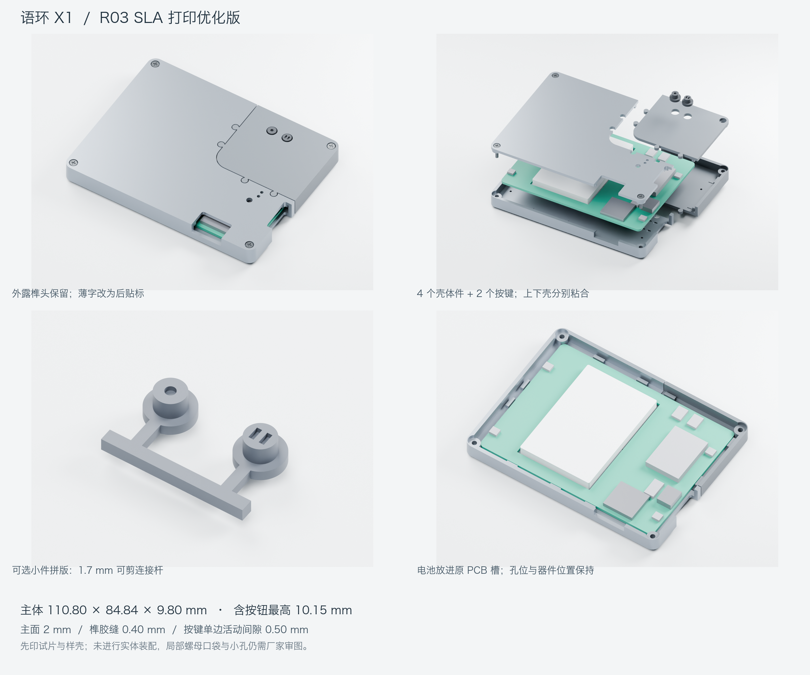

# 语环 X1 · Yuhuan X1

**重要的，回头还在。**

语环 X1 是一款录音卡原型：持续保留最近 24 小时的录音，按键回溯保存已经发生的对话，再同步到 Android 手机。本仓库汇集硬件、ESP32-S3 固件、Android App、可打印外壳与产品演示工程。

[快速开始](#快速开始) · [下载文件](outputs/README.md) · [当前进度](docs/PROJECT_STATUS.md) · [参与修改](CONTRIBUTING.md)



## 功能与进度

| 功能 | 当前进度 |
|---|---|
| 后台循环录音、最近 24 小时保留窗口 | 固件 Demo 已实现，待实板长时间测试 |
| 手动录音、暂停与继续 | 双按键与 App 控制已实现 |
| 一键保存前 1 小时，连按 N 次保存前 N 小时 | 通过持久化保护标记实现，最多 24 小时 |
| 平时一麦检测人声，语音时启用四路采集 | 固件已实现时钟切换与声道选择，输出单声道 |
| BLE 控制、局域网传输、手机本地保存 | 固件与 Android Demo 已实现，待真实链路联调 |
| 语音转写、AI 摘要、信息提取与提醒 | 后续开发计划 |

当前为 **Demo 0.1.0 / 外壳 R03**。软件有构建与测试记录，结构有几何检查；PCB 上电、实际打印装配和电池续航尚未实测。24 小时指录音保留窗口。

## 工程导航

| 目录 | 内容 | 从这里开始 |
|---|---|---|
| [`hardware/`](hardware/) | EasyEDA Pro 原生 PCB、审查与改线记录 | [硬件说明](hardware/README.md) |
| [`firmware/`](firmware/) | ESP32-S3 固件、同步协议、测试与烧录产物 | [固件说明](firmware/README.md) |
| [`android/`](android/) | Kotlin / Jetpack Compose App、界面与测试 | [Android 说明](android/README.md) |
| [`enclosure/`](enclosure/) | R01–R03 CAD 源码、STEP、STL 与预览 | [版本与打印入口](enclosure/README.md) |
| [`media/`](media/) | 产品影片、Blender / Three.js 工程 | [影片入口](media/README.md) |
| [`docs/`](docs/) | 项目进度、版本关系、目录迁移说明 | [项目状态](docs/PROJECT_STATUS.md) |
| [`outputs/`](outputs/) | 可直接下载的 APK、ZIP、影片与校验文件 | [下载索引](outputs/README.md) |

## 快速开始

```sh
git clone https://github.com/wyatt-liao/yuhuan-x1.git
cd yuhuan-x1
```

- **体验 Android Demo：** 从[下载索引](outputs/README.md)获取 APK，或在 Android Studio 打开 `android/`。APK 使用开发签名。
- **构建固件：** 激活 ESP-IDF v5.5.5 环境，在 `firmware/` 运行 `idf.py set-target esp32s3`、`idf.py build`。烧录与引脚映射见[固件说明](firmware/README.md)。
- **打印外壳：** 优先阅读 [R03 打印与拼版说明](enclosure/r03/README-打印与拼版说明.md)。主体厚 9.80 mm；两个小按键可选连桥拼版，打印后剪除连接条。R02 的 7.60 mm 薄版保留作设计对照。
- **查看 App 接口：** 设备侧见 [PROTOCOL.md](firmware/PROTOCOL.md)，手机侧见 [DEVICE_PROTOCOL.md](android/docs/DEVICE_PROTOCOL.md)。
- **播放产品影片：** 打开[影片下载](outputs/README.md#产品影片)，或按 [media/film/README.md](media/film/README.md) 启动本地播放器。

SDK、工具链、模拟器、下载缓存与本机配置不入库。各模块可独立打开和构建。

## 版本说明

当前固件与 App 对应**独立四麦时钟 / 数据、双按键** PCB。硬件审查目录保留改线前后的记录，使用时以[改线说明](hardware/reviews/语环X1-本次改线说明.md)和原生工程为准。

影片使用 Voloop X1 英文字标，包含 6 mm 外观目标和 AI 功能愿景。实际打印结构以 R03 CAD 为准，已实现的软件功能以模块 README 为准。历史 ZIP 是原交付快照；继续开发使用分类后的源码目录。

## 使用与第三方许可

仓库公开供查看与交流，原创代码、硬件、结构和媒体的进一步使用授权尚未指定开源许可证。第三方组件保留原许可证，见 [NOTICE.md](NOTICE.md)。
