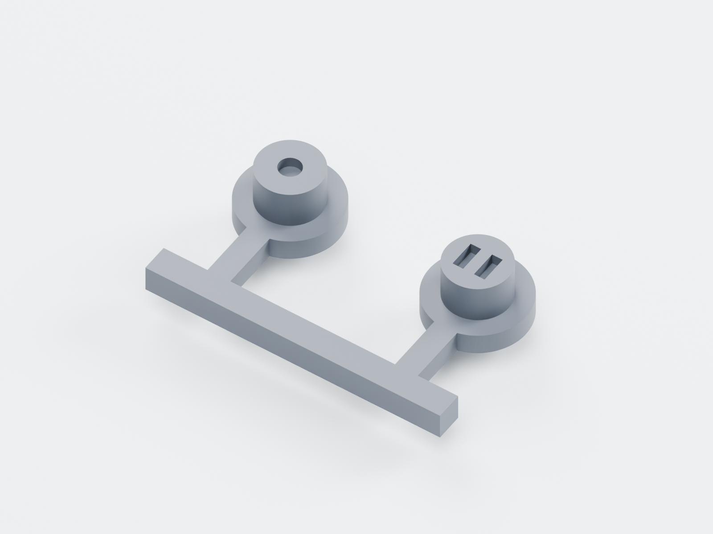

# 外壳与打印件

首件优先使用 **R03 SLA 树脂打印版**。外露圆头榫接造型保留；未来铝件与塑料天线区的材料划分也保留在独立零件中。

| 版本 | 定位 | 文件 |
|---|---|---|
| [R03](r03/README-打印与拼版说明.md) | 当前打印样壳，主体厚 9.80 mm，主面 / 侧壁 2 mm | [STL](r03/stl/)、[按键连桥 STL](r03/stl_optional/)、[STEP](r03/step/)、[源码](r03/source/) |
| [R02](r02/README-先读我.md) | 7.60 mm 薄版铝塑融合设计，保留对照 | [STL](r02/stl/)、[STEP](r02/step/)、[源码](r02/source/) |
| [R01](r01/) | 初始螺丝固定样壳记录 | [STL](r01/stl/)、[STEP](r01/step/)、[源码](r01/source/) |

完整 ZIP 和校验文件见[下载索引](../outputs/README.md#外壳打印包)。



R03 连桥版将两个按键连接为一个实体，只需在单独按键和连桥版中选一套；打印后剪去连接条并磨平法兰外缘。普通外壳仍按独立零件打印，装配参考模型不用于整机一体打印。

R03 使用 CadQuery 2.5.2。安装依赖后，从本目录执行：

```sh
python3 r03/source/build_print_r03.py --parameters r03/source/parameters.json --out /absolute/path/x1-r03-build
```

将新构建写入独立目录，便于与已交付的几何检查和 SHA-256 清单比较。预览渲染另需 Blender，具体参数见 `r03/source/render_print_r03.py`。

几何检查见各版 `verification/`。尚未实际打印装配；电池成品尺寸和部分器件高度仍需核实，局部薄壁与小孔需由加工方审图。未来金属件应使用 STEP 另做 CNC 工艺评审。
