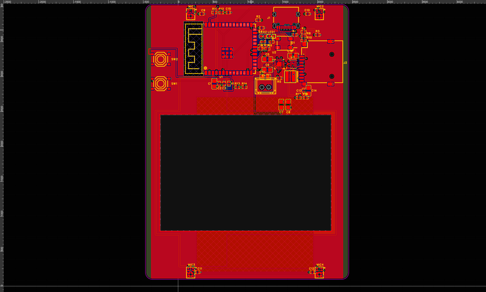

> 历史基线说明：本文审查的是麦克风/按键改线前的版本。2026-10-18 已完成的后续修改与验证见「语环X1-本次改线说明.md」。本文原始审查证据保持不变。

**PCB1 投产前审查｜2026 年 10 月 18 日**

**结论：当前版本不建议直接批量投产。先整改电源和 USB 布局，完成装配审查，再制作少量工程样机验证。** 这是依据当前工程数据作出的设计审查意见，尚无实物测试结果支持量产放行。

审查对象：嘉立创 EDA 专业版当前窗口中的 `MeetCard-AI-repair-loop-20261018 / Board1 / PCB1`，对应 `Schematic1` 的 P1–P4。通过 EasyEDA Agent 1.13.1 和 EasyEDA Pro 4.1.60 的原生接口只读检查了器件、逐脚网络、走线、过孔、铺铜、规则和工程内封装，并导出了工程证据。没有修改电路或 PCB。起止快照的设计语义哈希一致。

用户确认的电池：**504060、标称 3.7V、2000mAh、可充电、自带保护板**。尚未提供电池规格书、允许充电电流及温度范围、保护板温度保护能力、USB 电源规格、最大工作负载和样机测试结果。

**已通过的检查，以及结论的边界**

| 检查 | 结果 | 能说明的范围 |
|---|---|---|
| 原生 PCB DRC，两次读取 | 均通过，0 项违规 | 当前工程规则下未报告违规；不覆盖电源稳定性、信号完整性或实物性能 |
| 原理图与 PCB 对账 | 51 个器件一致；227 个焊盘实例网络一致 | 未发现器件遗漏、额外器件、身份或网名不一致；同号分割焊盘按实例计数 |
| 原生原理图 DRC | 0 致命、0 错误、8 警告 | 接口只返回警告总数，未提供逐条内容；这些警告仍需在 EDA 中逐项复核 |
| 工程导出 | `.epro2` 导出成功，ZIP CRC 校验通过 | 保存了一份可追溯的检查证据，不等同于制造文件验收 |

**1．优先整改：U3 TPS63802 电源布局**

从实际焊盘和铜线测得以下路径。`1mil = 0.0254mm`。长度是工具在已列出的走线、圆弧和过孔中找到的中心线路径，不含过孔垂直长度，也不含铺铜、填充和电源平面的潜在并联通路，不能当作电流唯一通路或完整环路电感测量。

| 路径 | 测得长度 | 走线宽度 | 过孔与层序 |
|---|---:|---:|---|
| U3.10 VIN → C17.1 输入电容 | 18.22mm | 10mil / 0.254mm | 3 个；顶层 → 底层 → Inner2 → 顶层 |
| U3.9 L1 → 电感 L1.1 | 7.23mm | 10mil / 0.254mm | 2 个；顶层 → 底层 → 顶层 |
| U3.7 L2 → 电感 L1.2 | 5.54mm | 10mil / 0.254mm | 路径经过 1 个过孔节点，但连接层序保持顶层 |
| U3.4 FB → R17.2 | 16.51mm | 10mil / 0.254mm | 2 个；顶层 → 底层 → 顶层 |

C17 的 SYS_RAW 焊盘与 U3 VIN 焊盘直线距离约 **13.22mm**；另一颗同网电容 C7 更远。C16 输出电容的电源焊盘距 U3 VOUT 焊盘约 **4.44mm**。可见问题是输入电容远离芯片、开关节点绕行跨层、反馈网络远离芯片。

TI 要求输入、输出电容靠近芯片，功率路径短且宽，反馈走线避开 L1/L2 开关节点。[1] 据此判断，当前布局存在电源纹波、瞬态响应和 EMI 风险，**应先按厂家参考布局重排 U3、L1、输入/输出电容及 R17/R18**。目前没有示波器数据，不能断言已经发生振荡或掉电；也不能仅凭 10mil 线宽断言载流量不够。

证据：`path-U3-VIN-C17.json`、`path-U3-L1.json`、`path-U3-L2.json`、`path-U3-FB.json`、`pcb-final.json`。U3 到 C16 的辅助路径检查不包含铺铜，未找到路径的结果没有被判作开路。

**2．优先整改：USB D+、D− 缺少成对布线与阻抗验证**

| 端点 | 测得路径长度 | 层序 | 过孔 |
|---|---:|---|---:|
| J1.A6 → U1.14，USB_DP | 23.82mm | 顶层 → 底层 → Inner2 → 顶层 | 3 |
| J1.A7 → U1.13，USB_DM | 26.11mm | 顶层 → Inner1 → 顶层 | 2 |

两条信号的主要路径位于不同内层，未保持同层平行的差分对走法。读取到的差分对定义、等长组和网络类均为空；当前未取得与实际生产叠层匹配的阻抗计算及连续参考平面证据。

Espressif 对 ESP32-S3 USB 推荐平行、等长的差分布线，差分阻抗 90Ω ±10%，并控制换层和参考平面。[2] 建议按确定的四层叠层重新布线。上述端点路径相差约 2.29mm，但**不能仅凭这一长度差认定全速 USB 一定无法通信**。另外，51 个器件的清单中未识别到独立 USB ESD 保护器件，应结合接口可触及性、外壳及产品要求补做防护审查。[2]

证据：`path-USB-DP.json`、`path-USB-DM.json`、`pcb-report.json`、P1 原理图和器件清单。

**3．电池与充电：电流设置约 405mA，电池温度未被实际测量**

U2 是 BQ24073；R5（ISET）为 2.2kΩ，按厂家典型系数计算：`890 / 2200 ≈ 0.405A`，约为 2000mAh 电池的 **0.20C**。这是标称快充目标，实际电流存在器件及电阻误差。[3]

EN2 接地、EN1 接 VBUS，选择 USB500 模式，总输入限流约 500mA。运行负载会占用输入预算，实际电池充电电流可能更低；R16 的 2.2kΩ 在这个模式下不直接决定输入电流上限。[3]

R15 将 TS 通过固定 10kΩ 接地，等效绕过实际电池温度检测。自带保护板不能据此认定含有温度检测和充电温度切断，应确认保护板规格，或在电池上增加与充电芯片匹配的温度检测方案。[3]

芯片的 4.2V 充电设定需与这块电池的规格书核对。TMR 明确悬空对应默认约 5 小时快充安全定时，并非“漏装定时电阻”；在 2000mAh、电流约 405mA 且边用边充的条件下，应实测完整充电曲线及是否出现定时终止。[3]

证据：`sch-P2.json`、`connectivity-P2.json`。电池插头极性、保护板动作点、允许充电电流和高低温充电条件仍待实物及规格确认。

**4．装配问题：丝印和盘中孔需处理**

辅助检查报告了 **6 处丝印文字压焊盘**，建议移动：

| 文字 | 被覆盖焊盘 |
|---|---|
| BAT1 | C17.2 |
| C16 | D1.3 |
| C17 | C6.1 |
| L1 | U2.9 |
| R18 | C13.1 |
| U3 | C16.2 |

另有 **9 处过孔与焊盘重叠提示**，涉及 D1、J2 和 L1.1。应逐项确认焊接区域、阻焊开窗和工厂工艺；必要时将过孔移出焊盘，或采用经工厂确认的填孔、盖铜等工艺。普通盖油不等同于填孔盖铜。盘中孔并非一概不能制造，是否影响吸锡、焊点和成本取决于具体工艺。[4]

证据：`pcb-check.json`。辅助检查的 77 条警告没有被全部认定为缺陷；通用 3W、锐角、未铺电源铜及部分去耦距离提示不能直接作为不合格依据。完整器件本体/庭院碰撞审查也尚未完成。

**5．射频、麦克风和机械：样机前后还需要确认**

U1 为 ESP32-S3-WROOM-1-N16R8，PCB 天线朝左，天线仍处于主板轮廓内部，左侧还有开关和邻近铜。现有禁布区域不足以单独证明成品天线净空符合要求。应对照厂家模块摆放要求检查主板铜、外壳、电池与天线的空间关系，并在装壳后验证无线性能；Espressif 优先推荐让模块天线伸出底板边缘。[2]

MIC1–4 为 IM69D130 PDM 麦克风。两两共用数据线，并分别选择相反的 SELECT 状态，原理图连接思路与双麦复用相符；固件需使用与这些连线相匹配的 PDM 接收配置。PDM 不需要标准 I2S 的 WS 信号，因此 I2S_WS 单引脚网络本身没有被判为错误。[5][6]

工程内实际麦克风封装包含多层圆形切口，记录的半径为 13.78mil，对应直径约 **0.700mm**，所以没有判作“未开声孔”。Infineon 数据手册推荐 0.8mm PCB 声孔；应核对最终制造输出、器件声口位置、开孔和声学密封。[5] 本次尚未对导出的封装与全部现场实例做完整几何等价验证。

中部大开槽约 61.98 × 41.91mm；电池成品尺寸、线材和保护板外伸尺寸、固定方式、厚度及膨胀余量没有经过机械装配验证。型号 504060 不能代替成品电池尺寸图。

**建议的放行顺序**

1. 重排 TPS63802 电源回路，按生产叠层重布 USB，确认电池温度保护方案，处理丝印及盘中孔工艺，并清点 8 条原理图警告。
2. 重新运行原生 DRC、器件与网络对账，检查最终 Gerber、钻孔/铣槽、钢网、BOM、坐标和极性；与工厂确认叠层、阻抗及装配工艺。
3. 先做少量工程样机：覆盖电池高/低电量与 USB 供电、插拔和边用边充，叠加 Wi-Fi 发射、SD 写入和四麦同时工作，观察 3.3V 纹波、瞬态和复位，并测温升、完整充电和保护动作。
4. 验证 USB 双面插入、不同线材/主机、枚举和下载；验证四麦通道、录音噪声及 PDM 波形、SD 读写、装壳无线性能，再据结果决定小批试产与量产。

目前缺少上述硬件验证、完整机械/装配检查和生产工艺确认，因此不能给出“可直接量产”的放行意见。工程样机测试可在修订后开展；本次未提交任何生产订单。

**资料与证据**

以下均为厂家或制造商原始资料，查阅日期为 2026-10-18：

- [1] [TI TPS63802 数据手册，Layout Guidelines](https://www.ti.com/lit/ds/symlink/tps63802.pdf)
- [2] [Espressif ESP32-S3 PCB Layout Design，USB 与天线布局](https://docs.espressif.com/projects/esp-hardware-design-guidelines/en/latest/esp32s3/pcb-layout-design.html)
- [3] [TI BQ24072/BQ24073 数据手册，ISET、EN1/EN2、TS、Timers](https://www.ti.com/lit/ds/symlink/bq24073.pdf)
- [4] [JLCPCB Technical Guidance: Five Via Finishes](https://jlcpcb.com/blog/five-via-finishes)
- [5] [Infineon IM69D130 数据手册，接口与 PCB Design Recommendations](https://www.infineon.com/assets/row/public/documents/24/49/infineon-im69d130-datasheet-en.pdf)
- [6] [Espressif ESP32-S3 I2S/PDM 驱动文档](https://docs.espressif.com/projects/esp-idf/en/stable/esp32s3/api-reference/peripherals/i2s.html)

原始读取数据、检查结果和只读工程导出见同目录 `PCB1-检查证据.zip`。其中部分 `path-U3-*.json` 是 CLI 原样输出的文本，扩展名不代表 JSON。原生 DRC 与辅助分析的覆盖范围不同；辅助布局检查对 17 个多边形焊盘几何不支持，结果为 incomplete，其评分和飞线交叉数没有被作为短路或未布通证据。

项目 UUID：`6e7fb6759eab460cbbc49ac9e7796a0d`；PCB UUID：`c513f79d0042e6d9`。起止设计语义 SHA-256：`bbdfc90a5b9f2a4929e4e067c2c2222ed41e1369b130a65f3c53ebfcda5300c0`。

