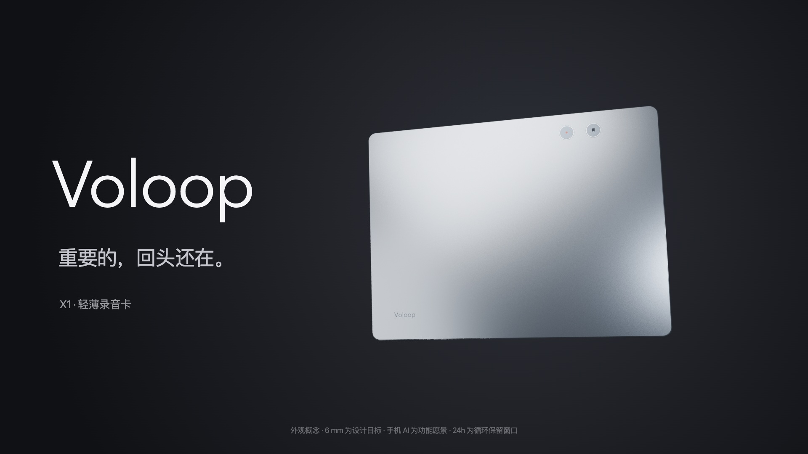

# Voloop X1 · 重要的，回头还在。



35 秒代码产品概念短片，1920×1080、30fps、16:9。用快切痛点字卡、倒流波形、按键微距和手机整理场景，呈现“错过录音 → 回溯保存 → 信息成为下一步”的主线。采用系统无衬线正文、Avenir Next 英文字标与收紧字距，结合留白、黑白字卡和金属反光。移除 HUD 标线、光环、粒子、技术计时器和装饰性坐标。机身正面与背面均渲染 Voloop 英文字标。音乐与按键音由代码合成，无外部音乐采样。

## 播放

直接播放交付的 `Voloop-X1-CG版-运镜修正.mp4`。实时预览在本目录运行：

```sh
python3 -m http.server 8765 --bind 127.0.0.1
```

浏览器打开 `http://127.0.0.1:8765/` 查看 Blender 成片；`http://127.0.0.1:8765/?live=1` 查看 Three.js 编排预览。成片使用浏览器原生播放、音量及进度控制；空格暂停或继续，方向键切换段落，F 全屏。初始暂停封面为最终产品镜头。所有模型、依赖和配乐在本地，使用本机系统字体；不需要账号或 API 密钥。

## 分镜

| 时间 | 画面与信息 |
|---|---|
| 00–05 | 时间、灵感、对话一闪而过；没按录音就错过 |
| 05–08 | “往回。保存。”与倒流波形，机身亮相 |
| 08–10.5 | 24H 循环记录保留窗口 |
| 10.5–17 | 真实位置的回溯键；按一次保存前 1 小时，连按 N 次保存前 N 小时 |
| 17–21 | 第二个痛点：录下来，仍需一段段重听 |
| 21–27 | 手机同步、整理想法、提取待办、生成提醒；标注功能愿景 |
| 27–29 | 6 mm 外观设计目标与纯净侧面镜头 |
| 29–31 | 静时一麦、人声四麦，背面声孔响应示意 |
| 31–35 | Voloop X1；重要的，回头还在 |

## 连续运镜与 CG 渲染

成片模型使用 Blender EEVEE Next、PBR 金属材质、面光源、柔和阴影及真实倒角几何渲染。另附一张 Cycles 32 采样路径追踪试渲染图供材质参考；整部动画的渲染器为 EEVEE Next。Three.js 版本用于快速编排和交互预览，材质表现与 Blender 成片不同。

`motion.js` 定义一条覆盖 0–35 秒的全局轨迹。位置、比例、镜头位置、注视点和焦距使用五次 Hermite 曲线，关键点共享速度和加速度；旋转角保持连续累积。文字分镜不会重置模型与相机。轨迹按 30fps 烘焙到 Blender 文件，微距拉近、拉远、手机交接、侧面、背面和正面收尾连续衔接。灯光扫动与按键行程也随全局时间变化。9.05–10.85 秒以 1.8 秒完成推近，相机上方向固定为世界坐标 +Y；使用显式 right/up/back 基向量，避免俯视附近的 180° 翻转。`verification/motion-check.json` 检查了关键点连续性、2101 个采样点和任意顺序定位；`verification/camera-check.json` 检查完整相机朝向与烘焙位置。

`assets/Voloop-X1-CG.blend` 包含动画、灯光、材质、转为网格的 Voloop 字标，以及打包的手机界面纹理，无需外部字体文件。模型仍为视觉概念，不能代替结构 CAD。

重新渲染 Blender 场景可以使用：

```sh
blender -b assets/Voloop-X1-CG.blend -o /absolute/path/cg/frame-#### -s 1 -e 1050 -a
node tools/render.mjs --cg-dir /absolute/path/cg --cg-start 1 --cg-fps 30 --fps 30 --out ../Voloop-X1-CG版-运镜修正.mp4
```

若需完整路径追踪动画，可在 Blender 中切换到 Cycles，或命令行加入 `-E CYCLES`。渲染时间会增加。原始按帧 PNG 不放入源码压缩包；可从 Blender 文件重新生成。

## PCB 对齐依据

2026-10-18 对 EasyEDA 工程 `MeetCard-AI-repair-loop-20261018` 的 PCB1 进行只读回读。对比已有最终快照的 51 个元件，元件 ID、坐标、旋转及层面保持一致。本次只修改影片模型。

- PCB 在片中顺时针旋转 90°，板边约 100 × 74.041 mm；概念外壳约 103 × 77 × 6 mm。
- SW1、SW2 使用实际焊盘中心，正面按压，中心距 8.89 mm；REC 与 SAVE 图形分别对应录音和回溯键。
- USB 使用 J1 的边缘方向及切向坐标，TF 使用 J2 的边缘方向及切向坐标。外壳开口向外延伸属于概念结构。
- 四个背面声孔使用 MIC1–MIC4 原生封装的声孔偏移中心；底部进声的示意面与按键面相反。
- `product-data.js` 包含坐标变换、所有元件位置、板边和孔口数据。`verification/pcb-alignment.json` 包含来源、对齐结果及边界说明。

6 mm 是用户指定的设计目标。影片模型的 Z 包络约为 −0.3 至 +0.3 个模型单位（1 单位 = 10 mm）；未核验电池、PCB、连接器、壳体和装配公差的实际厚度堆叠。该模型用于视觉展示，不可作为开模或制造文件。

## 修改与导出

- `film.js`：确定性分镜、文字、波形、标注与画面合成；`window.film.render(seconds)` 可定位任意帧。
- `product.js`：Three.js 编排预览的模型与灯光。
- `motion.js`：全局非线性运镜轨迹；`tools/export_motion.mjs` 可导出 Blender 使用的逐帧坐标。
- `product-data.js`：PCB 衍生坐标数据；影片源码与 PCB 工程独立。
- `cinema.html`、`cinema.js`：Blender 成片播放器；`player.js`、`index.html?live=1`：编排预览。
- `tools/make_score.py`：35 秒、120 BPM 原创合成配乐；需要 NumPy。
- `tools/render.mjs`：隔离浏览器逐帧合成 MP4；使用 `--cg-dir` 时默认 35 秒、30fps、1050 帧；未指定时为 Three.js 60fps 预览导出。
- `vendor/`：Three.js 0.180.0 原版压缩库及 MIT 许可。

重新导出需要 Node.js、FFmpeg、Playwright 和支持 WebGL 的 Chromium。普通浏览器播放无需 npm 安装。`node tools/check_motion.mjs` 可重新检查运动轨迹；`blender -b assets/Voloop-X1-CG.blend --python tools/check_scene.py` 可检查烘焙后相机是否翻转。

```sh
npm install
npx playwright install chromium
npm run render -- --cg-dir /absolute/path/cg --cg-start 1 --out ../Voloop-X1-CG版-运镜修正.mp4
```

macOS 可使用已安装的 Chrome：

```sh
npm run render -- --chrome '/Applications/Google Chrome.app/Contents/MacOS/Google Chrome' --cg-dir /absolute/path/cg --cg-start 1 --out ../Voloop-X1-CG版-运镜修正.mp4
```

`--seconds 3` 可检查前三秒；CG 合成默认 30fps。导出同时生成封面和 `render-report.json`。GPU 与系统字体不同会造成轻微渲染差异。依赖位于统一目录时，可设 `X1_NODE_MODULES`；FFmpeg 不在 PATH 时可设 `FFMPEG_PATH`。

重建配乐：

```sh
python3 -m pip install numpy
python3 tools/make_score.py score.wav
ffmpeg -y -i score.wav -af loudnorm=I=-16:TP=-1.5:LRA=7 -ar 48000 -c:a aac -b:a 192k assets/score.m4a
```

## 产品口径与许可

24H 指循环录音保留窗口，不是实测电池续航。手机 AI、待办、提醒及界面属于后续功能愿景，一麦与四麦为工作模式示意，不构成声学校准或量产验证。外观为工业设计概念，材质、工艺和真实装配尺寸尚待结构验证。

本次新写的影片和音乐源码可供本产品修改、使用和宣传。未使用苹果、索尼标识、广告素材或音乐。Three.js 保留 MIT 许可，见 `vendor/THREE-LICENSE.txt`。
